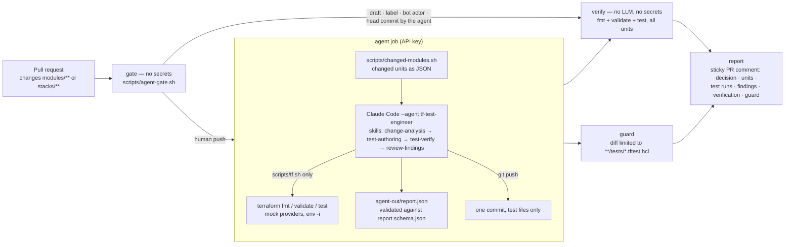

# Terraform Platform Base

A small Terraform repository for a data platform on Azure: networking, storage, secrets, monitoring, data integration, analytics and a function app.

## Layout

```text
modules/            Reusable modules. Each has main.tf, variables.tf, outputs.tf and versions.tf.
  <module>/tests/   Tests for a module, where they exist. Run them from the module folder.
stacks/
  data-platform/    The stack that uses the modules. One set of variables per environment in envs/.
```

## Requirements

- Terraform 1.9 or newer
- Internet access to download providers
- No Azure subscription or credentials

## Run the tests of a module

The tests use a mocked `azurerm` provider, so they need no credentials.

```sh
cd modules/storage-account
terraform init -backend=false
terraform test
```

## Check the stack

```sh
cd stacks/data-platform
terraform init -backend=false
terraform fmt -check -recursive ../..
terraform validate
```

The stack has no backend configured. A real deployment would need one, and credentials for it.

## Conventions

- Resource files in a stack and modules use `main.tf`, `variables.tf`, `outputs.tf` and `versions.tf`.
- Use `for_each` rather than `count` for repeated resources.
- Environments are `dev`, `uat` and `prod`.
- Format code with `terraform fmt -recursive` before committing.

## Test agent

Pull requests that change `modules/**` or `stacks/**` are handled by a custom
[Claude Code](https://code.claude.com) agent that writes and verifies
`terraform test` suites and reports findings to reviewers. It never changes
infrastructure code. Everyday commands:

```sh
scripts/tf.sh test modules/<name>   # run one unit's tests (hermetic wrapper)
make verify                         # fmt + validate + test for every unit (what CI runs)
make test                           # bats suites for the scripts + make verify
make agent                          # run the agent locally on the current branch vs main
make agent-all                      # full coverage pass over every unit
```

Design decisions, trade-offs, assumptions, limitations and the production
view are in [SOLUTION.md](SOLUTION.md). Example pull request handled end to
end by the agent in CI: [#5](https://github.com/romankovsv/claudfide-agent-tf/pull/5).
The test suites of all nine units were produced by the same agent in a local
run: [#2](https://github.com/romankovsv/claudfide-agent-tf/pull/2).

### Architecture



| Component | Where | Role |
|---|---|---|
| Custom agent | `.claude/agents/tf-test-engineer.md` | System prompt, model (`sonnet`), preloaded skills, tool restrictions, operating procedure, the rules the agent may not cross. The same file runs in CI (`claude-code-action`) and on a laptop (`claude --agent tf-test-engineer`). |
| Reusable skills | `.claude/skills/tf-change-analysis`, `tf-test-authoring`, `tf-test-verify`, `tf-review-findings` | Four `SKILL.md` files with reference material (test patterns, mock limits, review checklist). Preloaded into the agent in this order; also usable as `/tf-test-authoring` etc. in any Claude Code session in this repo. |
| Tool allow-list | `.github/workflows/tf-test-agent.yml` (`--allowedTools`), `.claude/settings.json` (deny-list), `scripts/run-agent-local.sh` | Read/Grep/Glob/Edit/Write/Skill, `scripts/tf.sh`, `scripts/changed-modules.sh` and a handful of `git` commands. No raw `terraform`, no network tools, no `gh`, no history rewriting. |
| Terraform wrapper | `scripts/tf.sh` | The only way Terraform runs here: `env -i`, fixed flags, read-only lock files, five subcommands (`init`, `fmt`, `fmt-fix`, `validate`, `test`). `terraform test` executes repository code (`data "external"`), so it must never inherit the job's secrets. |
| Deterministic analysis | `scripts/changed-modules.sh` | Which units changed and how (code, variables, outputs, tests, lock, scripts…) computed by git, not by the LLM; fed to the agent as data. |
| Gate | `scripts/agent-gate.sh` | Decides whether the agent may run: not on drafts, not with the `tf-tests:skip` label, not for bot actors, never on a head commit the agent made itself. Checked out from the base branch. |
| Guard | `scripts/guard-agent-diff.sh` | Fails the run if anything but `modules/*/tests/*.tftest.hcl` or `stacks/*/tests/*.tftest.hcl` changed between the PR head and the branch tip. Checked out from the base branch. |
| Independent verification | `scripts/verify.sh` | `fmt`, `validate`, `terraform test` for every unit on the branch tip; JUnit, logs and a markdown table as artifacts. No LLM, no secrets. |
| Report | `scripts/report.schema.json`, `validate-report.py`, `render-report.sh`, `post-comment.sh`, `transcript-summary.sh` | The agent writes a JSON report; CI validates it, renders it with the verification table and the guard output, and updates one sticky comment per PR (a second one for verification-only runs). |
| Script tests | `tests/scripts/*.bats` | 63 tests with a fake `terraform` and a fake `gh`: wrapper, change analysis, gate, guard, verification, rendering, comment update, transcript summary. Run by `make test` and by CI. |

### What happens on a pull request

1. **gate** — `scripts/agent-gate.sh` looks at the event (draft, labels, actor) and at the author of the head commit. The agent runs only for a human push on a ready pull request.
2. **agent** — Terraform and the providers are installed, the API key is checked with one minimal call, Claude Code is started with `--agent tf-test-engineer`, a turn and budget cap, the tool allow-list and a prompt that carries only context (repository, PR, base/head, the change JSON). The agent walks its four skills: decide per unit whether tests must be created, updated or left alone; write them; run them through `scripts/tf.sh`; review the change against the findings checklist. It commits only test files whose suite passes, pushes to the PR branch, and writes `agent-out/report.json`.
3. **verify** — the branch tip (including the agent's commit, if any) goes through `fmt`, `validate` and `terraform test` for all units, with no LLM and no secrets. This is the oracle; the agent's own "all tests pass" is only self-reported.
4. **guard** — the diff between the PR head and the branch tip may contain test files only.
5. **report** — one sticky comment: decision, per-unit actions and reasons, the agent's test runs, findings for reviewers with severity and location, the independent verification table and the guard output. If the agent failed, timed out or ran out of budget, the comment says so and shows what it did.

The agent's push re-triggers the workflow; the gate skips the agent on that commit and the run only verifies it, in a second sticky comment.

### How the LLM is controlled and verified

- **Scope by enforcement, not by instruction.** The agent is told to touch only test files; the `guard` job proves it, and the `gate` and `guard` scripts come from the base branch, so a pull request cannot change the controls applied to it. `claude-code-action` restores `.claude/` from the base branch for the same reason.
- **Nothing the agent says is trusted without a check.** The report must match a JSON schema; test results are re-established by the `verify` job; the comment is assembled by scripts, not by the agent.
- **Least privilege.** A short tool allow-list; Terraform only through a hermetic wrapper (`env -i`) on top of Claude Code's own subprocess environment scrubbing; workflow permissions per job; SHA-pinned actions; `pull_request` (not `pull_request_target`), so forks never see secrets; a per-PR concurrency queue; turn, budget and time caps.
- **Prompt-injection posture.** Everything inside the pull request (diffs, files, comments, the change JSON) is declared data, not instructions, in the agent's system prompt — and the enforcement above holds even if that fails.
- **Deterministic where possible.** Change classification, the gate, the guard, verification, rendering and comment updates are shell scripts with bats tests. The LLM is used for the judgement calls only: what a change means for tests, how to assert it, what a reviewer should know.

### How the task requirements are met

| Requirement | How it is met | Where to look |
|---|---|---|
| A custom agent with reusable skills, in an agent environment of my choice | Claude Code: one agent definition and four skills, versioned in the repository and used both by `claude-code-action` in CI and by the `claude` CLI locally. | `.claude/agents/`, `.claude/skills/`, [SOLUTION.md §1, §3](SOLUTION.md) |
| Missing tests added, coverage of existing modules improved | The base repository shipped tests for 3 of 8 modules. The agent's full coverage pass produced suites for the 5 remaining modules and the stack and extended two existing suites: 9 units, 36 test runs, all green. | [#2](https://github.com/romankovsv/claudfide-agent-tf/pull/2), `modules/*/tests`, `stacks/*/tests` |
| An automated pull request workflow that creates or updates tests for changed Terraform code, when the agent judges it appropriate | `tf-test-agent.yml` runs on every PR touching `modules/**` or `stacks/**`. `changed-modules.sh` says what changed; the `tf-change-analysis` skill decides per unit (`created` / `updated` / `unchanged` / `skipped`) and the report states the reason. Formatting-only, lock-only and tests-only changes get no new tests. | `.github/workflows/tf-test-agent.yml`, `scripts/changed-modules.sh`, `.claude/skills/tf-change-analysis` |
| Runs automatically for pull requests | `on: pull_request` (opened, synchronize, reopened, ready_for_review) with a path filter; opt-out per PR with the `tf-tests:skip` label; drafts are ignored. | `.github/workflows/tf-test-agent.yml` |
| Generated or updated tests are verified by running them | Twice: the agent runs every touched unit through `scripts/tf.sh` and may only commit passing suites; the `verify` job then re-runs `fmt`, `validate` and `terraform test` for all units on the branch tip, without the LLM or any secret. | `.claude/skills/tf-test-verify`, `scripts/verify.sh` |
| Results are available in the pull request that started the run | One sticky comment per PR (updated in place), GitHub check runs for every job, JUnit/logs/report as workflow artifacts, failures as annotations. | `scripts/render-report.sh`, `scripts/post-comment.sh` |
| The agent works inside that pull request and opens no other pull requests | It pushes one `test(<unit>): …` commit to the PR branch. It has no `gh` tool, no branch or rebase commands, and the guard rejects rewritten history. | `.claude/agents/tf-test-engineer.md`, `.claude/settings.json`, `scripts/guard-agent-diff.sh` |
| It tells reviewers what they should know; decisions about the infrastructure code stay with people | The `tf-review-findings` skill produces findings (severity, unit, file:line, detail, suggestion) rendered in the comment. A test that fails because the code is wrong is not committed; it becomes a finding. The agent cannot change `.tf` files: by instruction, by deny-list and by the guard. | `.claude/skills/tf-review-findings`, PR [#5](https://github.com/romankovsv/claudfide-agent-tf/pull/5) comment |
| Works without an Azure subscription or any cloud credentials; creates no cloud resources | All tests use `mock_provider` and `command = plan`; the only secret in CI is the Anthropic API key, visible to the agent job alone. What such tests can and cannot show is spelled out. | `*/tests/*.tftest.hcl`, [SOLUTION.md §5](SOLUTION.md) |
| Everything operates on GitHub; LLMs are used, controlled and verified | Repository, pull requests, workflow and results live here. Control and verification: allow-list, hermetic wrapper, base-branch controls, schema-validated report, independent verification, guard, caps — see the section above. | this README, [SOLUTION.md §1](SOLUTION.md) |
| One example pull request on a real Terraform change, from analysis to results and findings | [#5](https://github.com/romankovsv/claudfide-agent-tf/pull/5): `ftps_state` made a validated variable in `modules/function-app`. The agent classified the change, added three test runs, verified 7/7, committed as `claude[bot]`, and reported one finding about the changed default; guard and verification are in the same comment. | [SOLUTION.md §4](SOLUTION.md) |
| Documentation of decisions, usage, structure, an example run, test limits, assumptions, limitations, scaling and production changes | Nine sections, in that order. | [SOLUTION.md](SOLUTION.md) |
